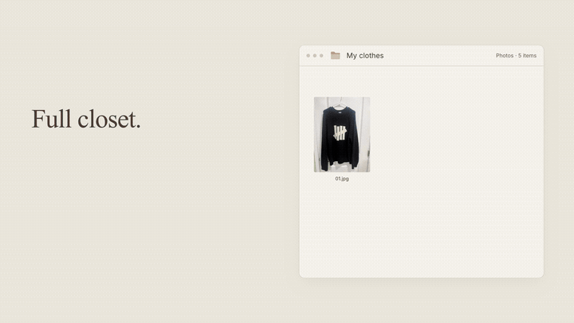
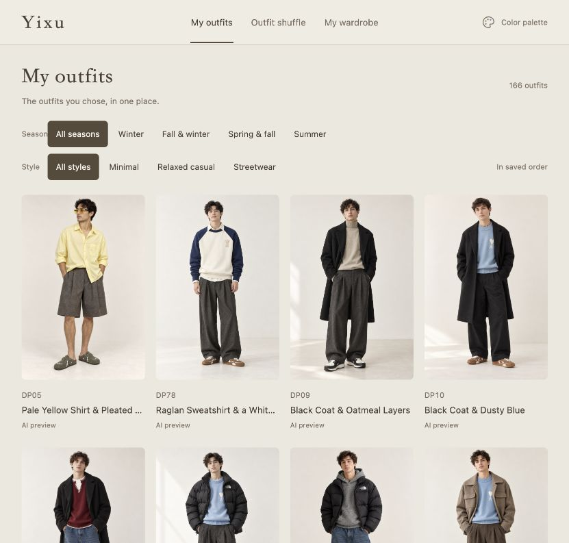
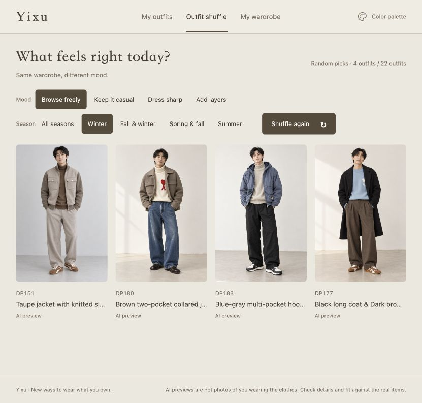
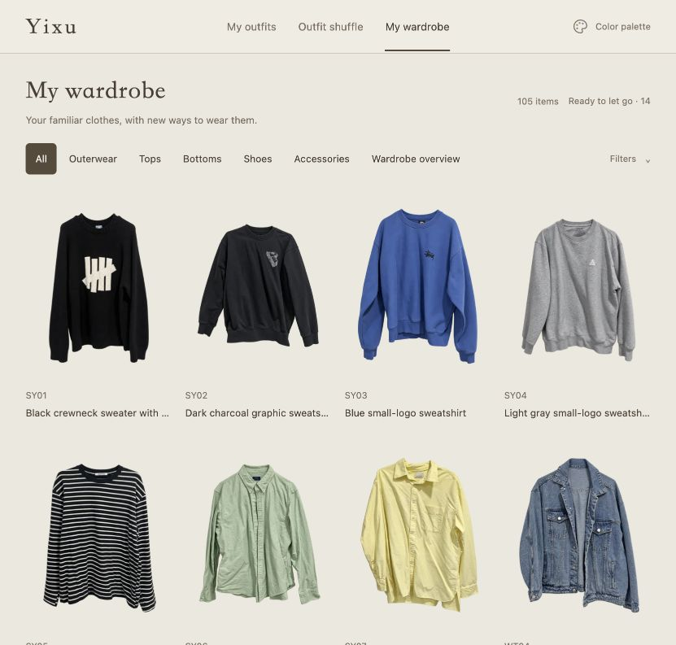
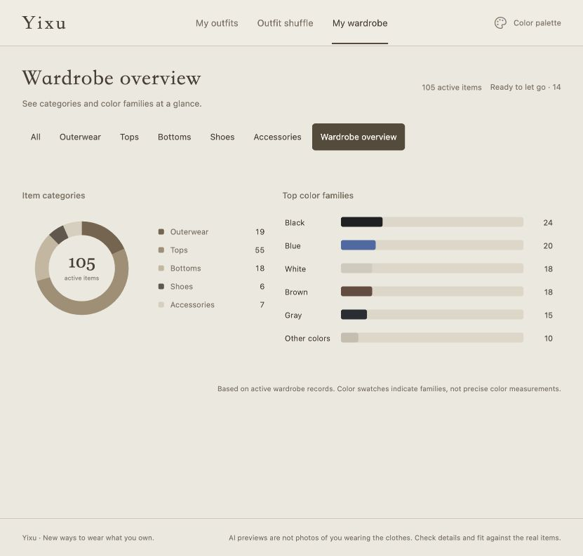

# Yixu

### A full closet. The same few outfits.

I turned my own clothes into a small wardrobe website, used AI to explore combinations, and kept the outfits I would actually wear. Before going out, I pick a season and browse a few looks. Before buying more, I can look at what I already own.

[Watch the intro](#see-it-in-13-seconds) · [Explore the features](#new-ways-to-wear-your-own-clothes) · [Get started](#get-started) · [中文版](https://github.com/hlckl123456/yixu-wardrobe-zh)

## See it in 13 seconds

[](https://github.com/hlckl123456/yixu-wardrobe-en/releases/download/demo-2026-10-22/yixu-intro-en.mp4)

**Click the preview for the 13.3-second video with music.** The animation above is silent. My clothing photos become a wardrobe, outfit ideas unfold, batches change, and the palette shifts. [Open or download the intro](https://github.com/hlckl123456/yixu-wardrobe-en/releases/download/demo-2026-10-22/yixu-intro-en.mp4). A [still from the ending](docs/media/video-poster.png) is also available. The [Chinese edition](https://github.com/hlckl123456/yixu-wardrobe-zh#先看完整演示) also has a full narrated walkthrough.

> These screenshots show my own wardrobe: 105 active items and 166 saved looks at the time of capture. The garments are clothes I own; the people wearing them are AI outfit illustrations, not photographs of me trying them on. The intro recreates the workflow with waiting omitted. A fresh download starts empty; presentation screenshots and videos are separate from the wardrobe data.

## New ways to wear your own clothes

### My outfits: keep the looks you would wear

I don’t keep everything AI suggests. If the trousers feel too formal, I change them. If the colors feel wrong, I try again. The looks I choose stay together in their saved order, with direct season and style filters.



Open a look for styling notes and its individual pieces. Open a piece to see the other outfits that use it. The combination on screen leads back to clothes in your own wardrobe.

### Outfit shuffle: decide what to wear today

There is no need to plan a whole week. Choose “Keep it casual,” “Dress sharp,” or “Add layers,” then a season. See up to four looks, shuffle again, and stop when something feels right.



The first batch is random too. Later batches prioritize looks you haven’t seen within that round. Shuffle draws from **eligible outfits you have already saved**; it does not call an AI model every time you click. An empty range stays empty rather than silently broadening your filters.

### My wardrobe: remember what you already have

Browse tops, bottoms, shoes and accessories directly. A wide desktop view shows four items across, with short labels and room for the clothes.



Find items that have never appeared in a saved outfit, or appear in only one or two. Ask AI to start with those pieces when suggesting something new, or reconsider whether you want to keep them.

These are **saved-outfit reference counts**, not real-world wear tracking. An unused item is not automatically marked for disposal.

## Small features that make it easier to use

| Feature | What it helps with |
| --- | --- |
| Wardrobe overview | See category and color-family distributions before adding more clothes. |
| Color palette | Switch the page between sand, rose, blue and sage without changing your wardrobe. |
| Ready to let go | Set items aside in a secondary view while retaining their codes, records and past outfit links. |
| Larger images and styling notes | Inspect the combination and read notes about hems or layers, then check the real clothes. |
| Planned outfits | Clearly distinguish unpurchased pieces from items you already own. |



## AI suggests. You choose.

I use Codex for photo preparation, outfit proposals and maintenance. The website displays the reviewed results. Other external AI tools can also follow the repository’s maintenance workflow.

These are examples of requests to an external AI assistant, rather than buttons built into the website:

> Organize these clothes into my wardrobe. Ask about anything you can’t see clearly; don’t invent a different garment.

> Use only clothes I own to suggest 10 casual summer looks. Show candidates first, and wait for my choices before saving them.

> Keep these looks in the order I selected. Leave the rest out for now.

You can revise trousers, shoes or colors before saving. Candidates stay separate from approved outfits until you choose them. Generated images can misrepresent details; compare color, texture and actual fit with your real clothes.

The [reusable AI collaboration guide](docs/AGENT-WORKFLOW.md) covers preparing photos, reviewing candidates, saving selected looks and handing the work to a new chat.

## You don’t have to photograph everything

If you have product images that match clothes you own, you can start with those. Confirm the exact style and color, then use the same intake process.

The next workflow I want to add is purchase-email and order collection. An authorized external AI tool could gather matching images from shopping emails or Taobao orders, backfill older purchases, and use Automation to prepare a review queue for new ones. Check returns, cancellations, duplicate purchases and whether you still own each piece before adding it.

**Prepared-image intake works today. Email and Taobao connections, and scheduled imports, are not built in yet.** Collection requires separately configured external tools and authorization.

## What you get

A wardrobe website you can run on your own computer, plus maintenance tools for adding records, saving outfits, backing up and restoring. By default, the database and images stay in the Git-ignored `private-data/` directory. The Chinese and English editions keep separate data directories.

This is a single-person local app. The website is for browsing; it has no upload or edit buttons, accounts, cloud sync, or access controls for public hosting. Browsing your saved wardrobe needs no AI API key. If you want AI photo preparation or outfit generation, use your own external tools and account. See the [security notes](SECURITY.md).

## Get started

You need **Node.js 24 or later**. Normal use has no additional npm runtime dependencies.

### Start with an empty wardrobe

```sh
git clone https://github.com/hlckl123456/yixu-wardrobe-en.git
cd yixu-wardrobe-en
npm start
```

Open [http://127.0.0.1:4184](http://127.0.0.1:4184/#outfits). The server listens only on your computer. Use `npm run status` to check it and `npm stop` to stop it; your data stays. On macOS, you can also double-click `Start Wardrobe.command` or `Stop Wardrobe.command`. Set `YIXU_NODE_BIN` if the launcher cannot find Node.

### Add your clothes and chosen outfits

1. Prepare clothing photos or matching product images, make cutouts, and compare them with the originals. Review and record any AI reconstruction first.
2. Follow the [maintenance guide](docs/MAINTENANCE.md#add-a-garment) to prepare records and add them with `scripts/intake.mjs`.
3. Create outfit candidates from your wardrobe, review the images, then save your choices with `scripts/save-owned-outfit.mjs`.

Only ordinary looks with images and currently active wardrobe items enter Outfit shuffle. Have your AI assistant read `AGENTS.md` and the [collaboration guide](docs/AGENT-WORKFLOW.md) before working on your photos.

<details>
<summary>Try a small synthetic sample first</summary>

```sh
npm run demo -- "$PWD/demo-data"
YIXU_DATA_DIR="$PWD/demo-data" node scripts/local.mjs start 4194
```

Open the [synthetic sample](http://127.0.0.1:4194/#outfits). It has three geometric garments and one outfit without an image, for checking the pages and relationships. Outfit shuffle will be empty; this is not the personal wardrobe shown in the video.

```sh
YIXU_DATA_DIR="$PWD/demo-data" node scripts/local.mjs stop 4194
```

Use a new, nonexistent directory. The command does not overwrite an existing wardrobe, and `demo-data/` is ignored by Git. The environment-variable syntax is for macOS and Linux. In PowerShell, set `$env:YIXU_DATA_DIR = "$PWD/demo-data"` before running the same Node commands.

</details>

Set `YIXU_DATA_DIR` to another absolute path if you prefer. Read the [backup and restore instructions](docs/MAINTENANCE.md) before moving your wardrobe. Keep the database and original photos out of GitHub.

[Maintenance](docs/MAINTENANCE.md) · [Architecture](docs/ARCHITECTURE.md) · [Sample walkthrough](docs/DEMO.md) · [AI collaboration](docs/AGENT-WORKFLOW.md) · [Interface copy](docs/UI-COPY.md)

After source changes, run `npm test` and `npm run check`. Code is under the [MIT License](LICENSE); see the [media notes](docs/media/README.md) for presentation assets.
